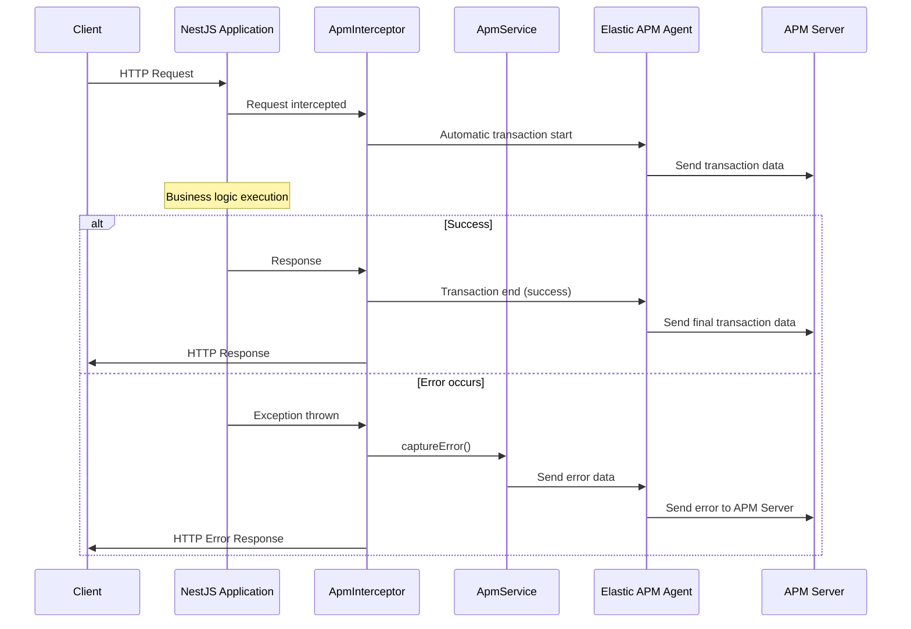
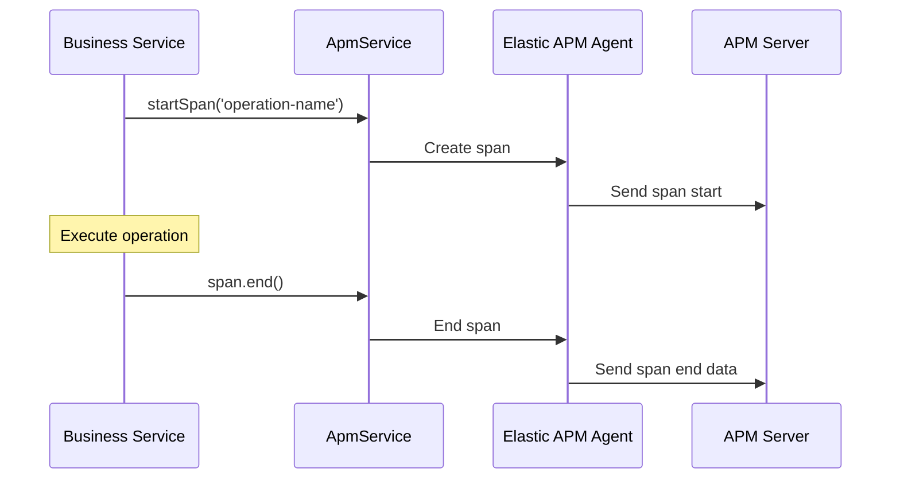
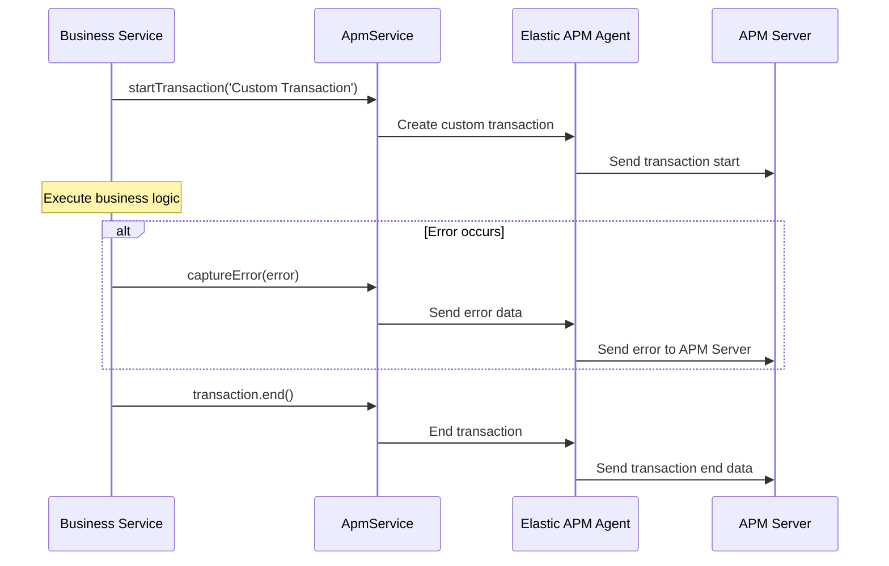
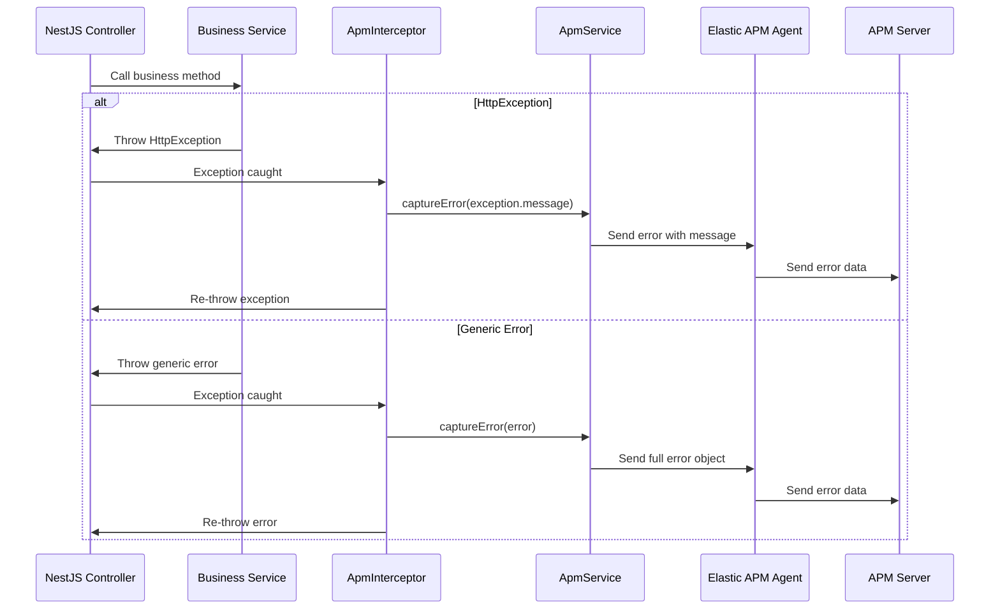
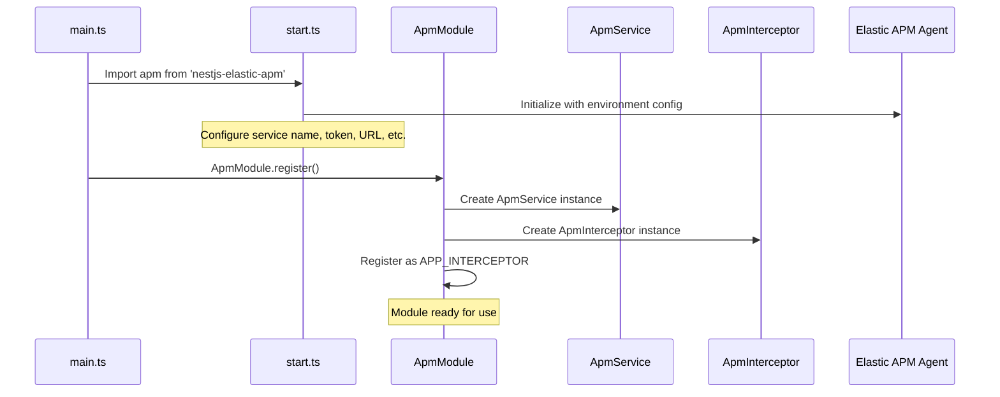
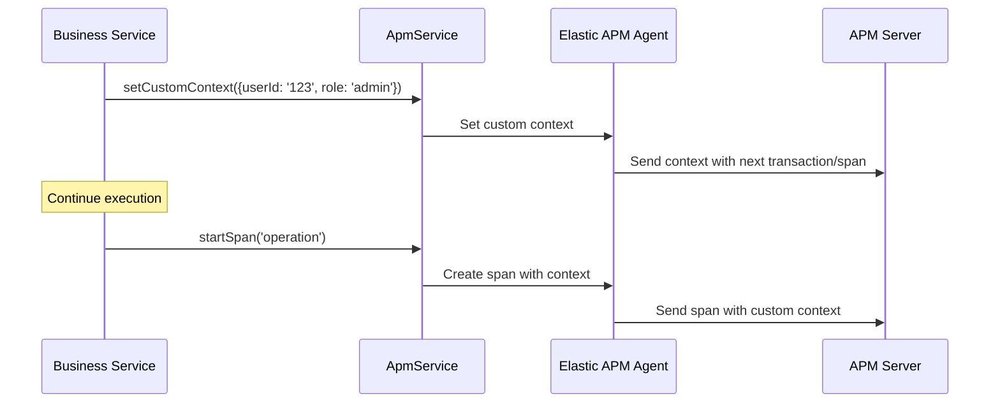

# System Workflows

This document describes the key workflows and interactions between the NestJS application, Elastic APM agent, and APM server.

## HTTP Request Flow



## Custom Span Creation



## Custom Transaction Flow



## Error Handling Workflow



## Module Initialization Flow



## Custom Context Setting



## Configuration Sources

The module uses the following environment variables for configuration:

- `ELASTIC_APM_ACTIVATE`: Enable/disable APM agent
- `ELASTIC_APM_SERVICE_NAME`: Override service name
- `ELASTIC_APM_SECRET_TOKEN`: APM Server authentication token
- `ELASTIC_APM_API_KEY`: APM Server API key authentication
- `ELASTIC_APM_SERVER_URL`: APM Server endpoint
- `ELASTIC_APM_DISABLE_INSTRUMENTATIONS`: Comma-separated list of disabled instrumentations

## Message Schemas

### Transaction Data
```json
{
  "id": "transaction-id",
  "trace_id": "trace-id",
  "name": "Transaction Name",
  "type": "request",
  "duration": 150.5,
  "timestamp": "2024-01-01T00:00:00.000Z",
  "context": {
    "user": { "id": "user-123" },
    "custom": { "business_data": "value" }
  }
}
```

### Error Data
```json
{
  "id": "error-id",
  "trace_id": "trace-id",
  "transaction_id": "transaction-id",
  "exception": {
    "message": "Error message",
    "type": "Error",
    "stacktrace": [...]
  },
  "timestamp": "2024-01-01T00:00:00.000Z"
}
```

### Span Data
```json
{
  "id": "span-id",
  "transaction_id": "transaction-id",
  "trace_id": "trace-id",
  "name": "Database Query",
  "type": "db",
  "subtype": "mysql",
  "action": "query",
  "duration": 25.3,
  "timestamp": "2024-01-01T00:00:00.000Z"
}
```
