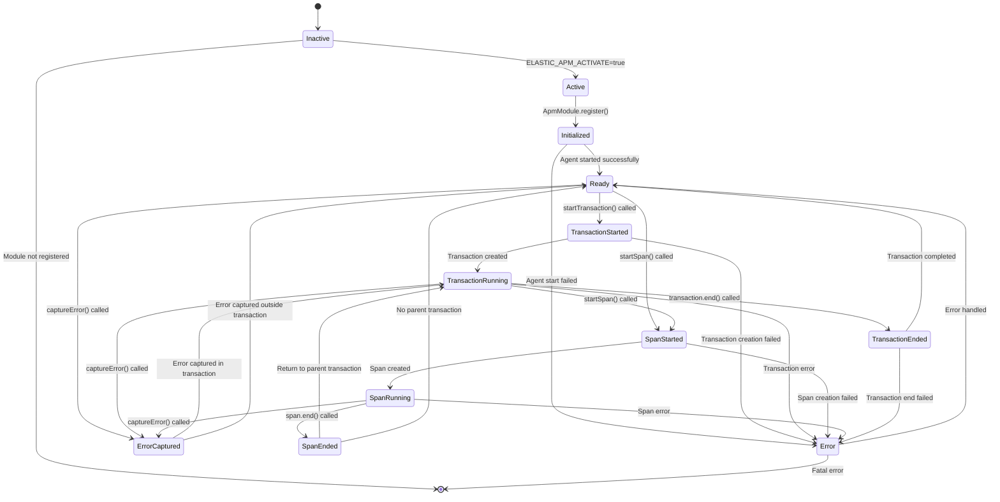
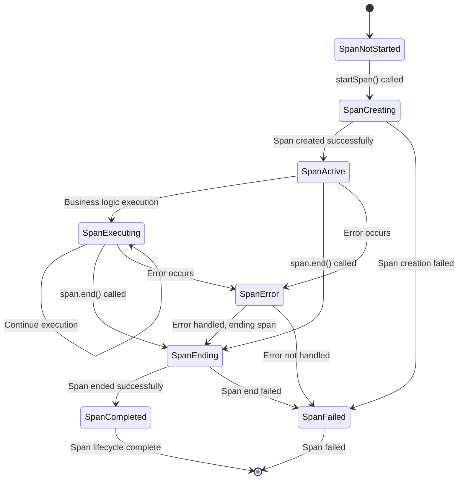
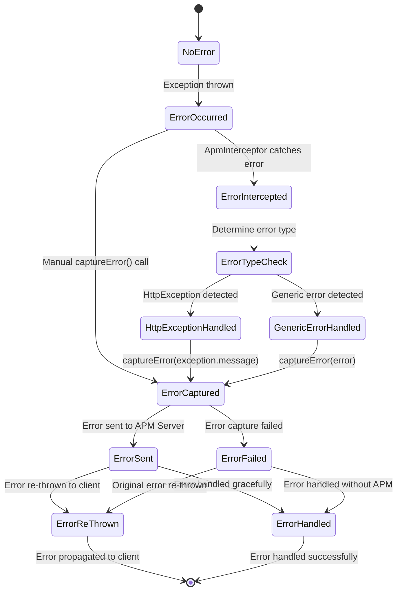
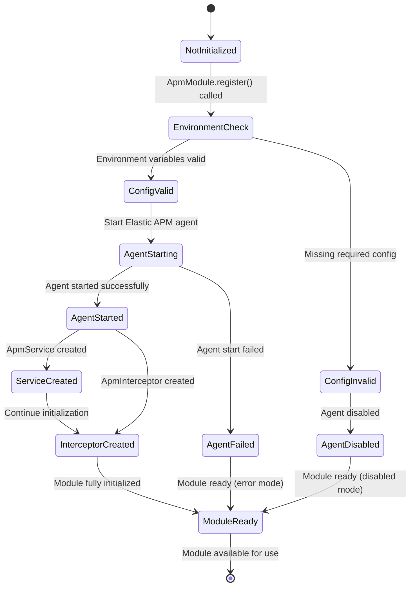
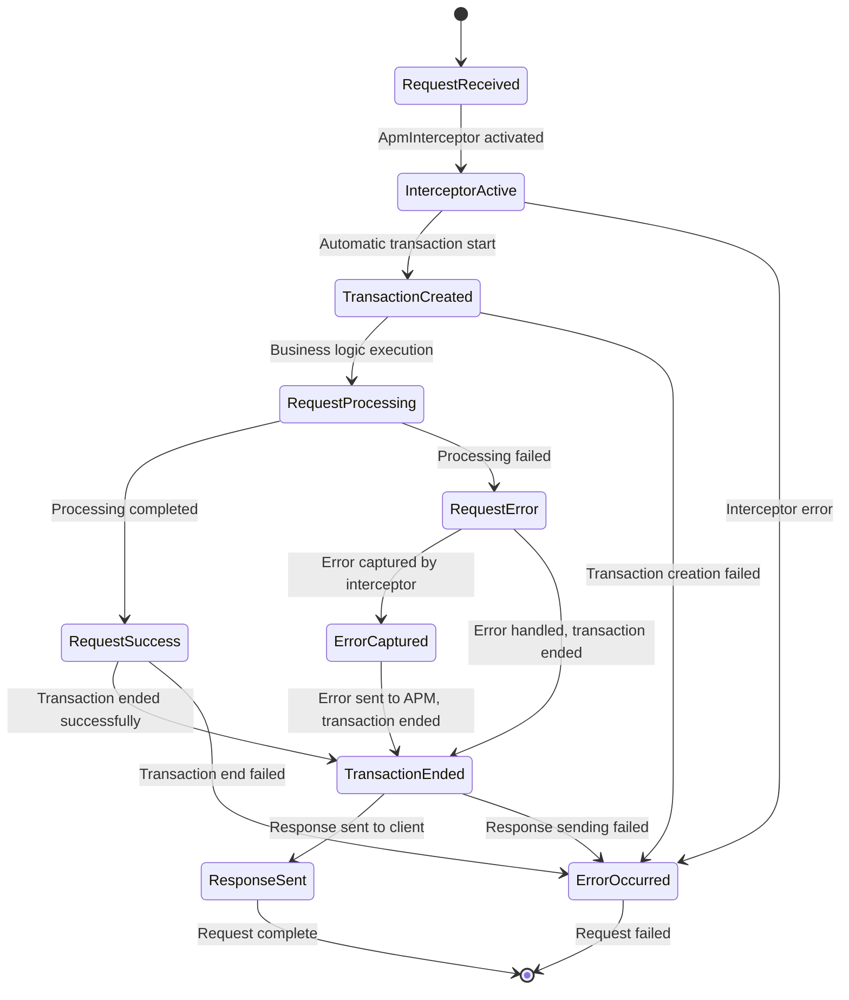

# State Machines

This document describes the state machines and lifecycle flows for APM transactions, spans, and error handling processes.

## Transaction Lifecycle State Machine

## Span Lifecycle State Machine

## Error Handling State Machine

## Module Initialization State Machine

## Request Processing State Machine

## State Transitions Table

| Trigger | From State | To State | Conditions |
|---------|------------|----------|------------|
| `ELASTIC_APM_ACTIVATE=true` | Inactive | Active | Environment variable set |
| `ApmModule.register()` | Active | Initialized | Module registration |
| Agent start success | Initialized | Ready | APM agent started |
| `startTransaction()` | Ready | TransactionStarted | Valid transaction name |
| `startSpan()` | Ready/TransactionRunning | SpanStarted | Valid span name |
| `captureError()` | Any | ErrorCaptured | Error object provided |
| `transaction.end()` | TransactionRunning | TransactionEnded | Transaction exists |
| `span.end()` | SpanRunning | SpanEnded | Span exists |
| Exception thrown | Any | ErrorOccurred | Unhandled exception |
| Interceptor catch | ErrorOccurred | ErrorIntercepted | HTTP request context |
| Manual capture | ErrorOccurred | ErrorCaptured | Direct service call |

## State Metadata

### Transaction States
- **Inactive**: APM agent not enabled
- **Active**: APM agent enabled but not initialized
- **Initialized**: Module registered, agent starting
- **Ready**: Agent ready to handle requests
- **TransactionStarted**: Custom transaction created
- **TransactionRunning**: Transaction active and collecting data
- **TransactionEnded**: Transaction completed and sent to APM server

### Span States
- **SpanNotStarted**: No span active
- **SpanCreating**: Span creation in progress
- **SpanActive**: Span created and ready
- **SpanExecuting**: Business logic running within span
- **SpanEnding**: Span ending process
- **SpanCompleted**: Span ended successfully
- **SpanFailed**: Span creation or execution failed

### Error States
- **NoError**: Normal operation
- **ErrorOccurred**: Exception or error detected
- **ErrorIntercepted**: Error caught by interceptor
- **ErrorTypeCheck**: Determining error type
- **ErrorCaptured**: Error captured by APM service
- **ErrorSent**: Error sent to APM server
- **ErrorReThrown**: Error propagated to client
- **ErrorHandled**: Error handled gracefully

## Error Handling Patterns

### Automatic Error Capture
1. Exception thrown in business logic
2. ApmInterceptor catches the exception
3. Error type determined (HttpException vs generic)
4. Error captured with appropriate context
5. Error sent to APM server
6. Original exception re-thrown

### Manual Error Capture
1. Developer calls `captureError()` directly
2. Error immediately sent to APM server
3. No automatic re-throwing
4. Developer controls error flow

### Transaction Error Handling
1. Error occurs within transaction
2. Error captured with transaction context
3. Transaction continues or ends based on business logic
4. Error data included in transaction

## Performance Considerations

- **State Transitions**: Minimal overhead for state changes
- **Error Capture**: Asynchronous to avoid blocking
- **Transaction Management**: Automatic cleanup on errors
- **Span Management**: Parent-child relationship preservation
- **Context Preservation**: Maintained across state transitions
